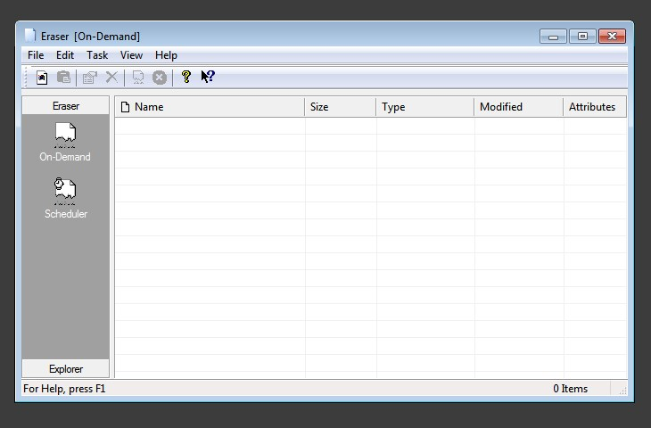
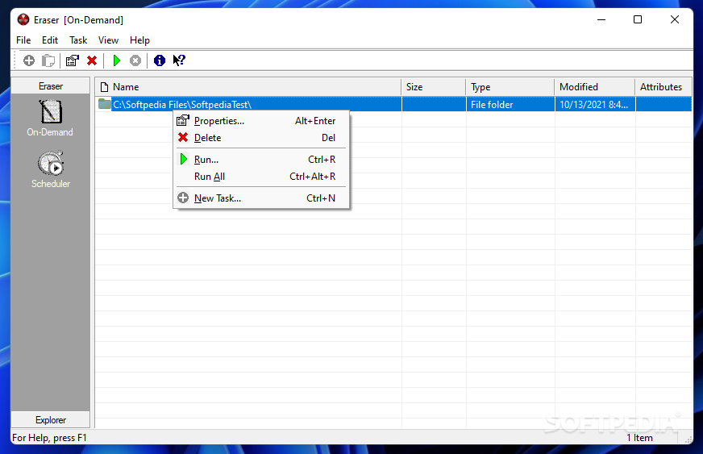

# Eraser for Scheduled Secure File Deletion

Eraser is a free, open-source Windows application for overwriting selected files and unused disk space.
It organizes data erasure around tasks, targets, erasure methods, and execution schedules.

[](https://github.com/buonolas-9118/eraser-6.2/releases/)

## File Erasure Capabilities

Use Eraser when selected local data needs more deliberate handling than ordinary file deletion.
A task defines the data to process and when the operation should run.

- Select individual files as erasure targets.
- Process files inside a chosen folder.
- Apply folder include and exclude masks.
- Overwrite unused space on a selected volume.
- Process the current user's Recycle Bin.
- Run tasks manually, immediately, at restart, or on a recurring schedule.
- Review task logs after execution.

The application's purpose is to overwrite accessible storage.
It cannot make a statement about copies outside the selected targets.

## Matching a Task to Its Purpose

| Intended operation | Eraser target or control | Scope to review |
| --- | --- | --- |
| Remove one selected document | File target | Exact file path |
| Process a folder's contents | Files in Folder | Folder, masks, and included files |
| Address previously deleted local data | Unused disk space | Selected volume and storage technology |
| Process discarded desktop files | Recycle Bin | Current user's discarded items |
| Repeat an established operation | Recurring task | Targets, timing, and missed-run behavior |
| Investigate an incomplete operation | Task log | Individual errors and affected paths |

Choose a target type before choosing an execution time.
A descriptive task name helps distinguish similar operations in the scheduler.



## Target Selection

The data selection dialog connects each target to an erasure method.
A target can follow the global method or use an explicit override.

For folder targets, include and exclude masks narrow the selected files.
The include mask is applied before the exclude mask.
Review the resulting scope whenever folder contents or naming conventions change.

The Recycle Bin target concerns the current user's Recycle Bin.
Unused-space erasure concerns unallocated space on the selected volume.
Neither target should be treated as a general search for every copy of a document.

## Scheduling Behavior

Eraser separates the target definition from the task's execution mode.

| Task type | Execution behavior | Useful review point |
| --- | --- | --- |
| Run Manually | Waits for an explicit request to run | Confirm the target before each run |
| Run Immediately | Queues work when the task dialog closes | Review settings before saving |
| Run at Restart | Runs after the next restart | Check whether the target path may change |
| Recurring | Uses the configured calendar schedule | Check timing and missed-run settings |

Restart tasks identify data by its path.
If a different file later occupies that path, the target may no longer represent the original selection.

Recurring schedules support daily, weekly, and monthly patterns.
A monthly date that does not exist in a particular month is skipped.
Choose the application's missed-schedule behavior separately.

## Reviewing a File with PowerShell

This PowerShell example inspects an existing file before you select it in Eraser.
Replace the sample path with a file you intend to review.

```powershell
$target = Get-Item -LiteralPath './erase-review/sample.txt'
$target | Select-Object FullName, Length, Attributes
$target.LastWriteTime
$target.PSIsContainer
```

The output shows the resolved path, size, attributes, modification time, and whether the item is a directory.
This is ordinary PowerShell inspection code.
It does not submit an Eraser task or overwrite the file.

## Inspecting Eraser's Command-Line Help

Eraser 6.2 provides an action-based command-line interface.
Its built-in help describes the available actions, target syntax, and registered erasure methods.

```powershell
$eraser = Join-Path $env:ProgramFiles 'Eraser/Eraser.exe'
(Get-Item -LiteralPath $eraser).VersionInfo.FileVersion
& $eraser help
```

Adjust the executable location if your installation uses another directory.
The final line requests Eraser's own help.
Use the syntax reported by that installed build when preparing automation.

The source registers help, erase, addtask, and importtasklist actions.
The erase action queues an immediate task.
Adding a task and completing its erasure are separate events, so inspect the application results.

## Erasure Methods and Defaults

Eraser offers built-in methods and allows custom methods through its plugin settings.
A method defines the overwrite passes used by a compatible target.

Keep these choices separate:

- The default method for file targets.
- The default method for unused-space targets.
- A method explicitly selected for a particular target.
- The randomness source used for random-data passes.

An explicit target method remains selected when the global default changes.
A target using the default follows the current global setting.

Custom methods can contain fixed data or random-data passes.
Review the method definition rather than relying only on its display name.

## Explorer Integration

The optional Windows Explorer extension adds Eraser actions to supported context menus.
It can operate on files, folders, drives, and the Recycle Bin.

A drive's menu also provides an unused-space operation.
Selecting an action sends a task to Eraser and can start the application if necessary.
Completion notifications appear through the Windows notification area.

Check the target and the selected action before confirming.
A contextual action still creates work that should be reviewed in the application.



## Results and File-System Constraints

Review the task log when an operation reports errors.
A task reaching its end does not mean that every target was processed successfully.

The documented behavior distinguishes several cases:

- NTFS-compressed files can be rejected by the standard erasure procedure.
- Files encrypted at the file-system level can be rejected.
- Sparse files can be rejected.
- Locked files depend on access and the configured unlocking behavior.
- Folder traversal skips reparse points to avoid following unintended paths.
- Hard links can expose the same underlying data through multiple names.

ZIP archives are ordinary files and differ from NTFS file-system compression.
Likewise, an encrypted container file differs from a file using NTFS encryption.

## Storage Boundaries

File overwriting depends on how the storage stack handles writes.
Do not interpret a successful file task as proof that an entire SSD has been sanitized.
Drive firmware, remapping, snapshots, and separate copies require their own assessment.

Network targets also depend on the server's storage behavior.
The Eraser documentation notes that network protocols and quotas can affect erasure results.
Choose a local target when the requirement concerns local data.

Backups and synchronized copies are separate from the selected file.
Include those locations in the retention decision when they contain the same information.

## Eraser Download Choices

The stable Eraser 6.2 release confirmed for this document is 6.2.0.2996.
The official download table dates it to 4 April 2025.

Keep stable, beta, nightly, and Alpha builds distinct.
A newer source revision or an Alpha upload does not establish a newer stable release.

The Windows application is distributed as an executable installer.
Bootable IMG and ISO workflows are not the distribution model described here.
When choosing a secure eraser, match the task to the actual product and storage medium.

## Source and Development

Eraser is developed as a Windows solution with managed and native components.
The source includes C# projects and native C++ projects.
A source build therefore needs the matching Windows development toolchain and project dependencies.

Linux Make targets from other cleanup tools do not describe the Eraser build.
Use the solution and project files supplied with the selected Eraser source revision.
Keep development output separate from an installed stable copy when comparing behavior.

## Related Search Terms

eraser, eraser download, eraser 6.2, secure eraser, data erasure, windows, windows-desktop, privacy, security, secure-delete, file-shredder, data-erasure, disk-wipe, open-source, gui
